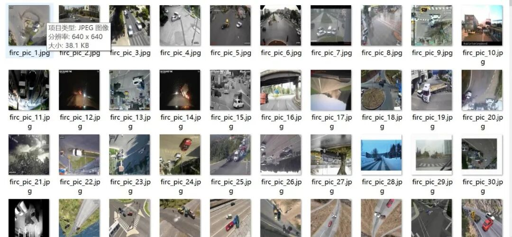
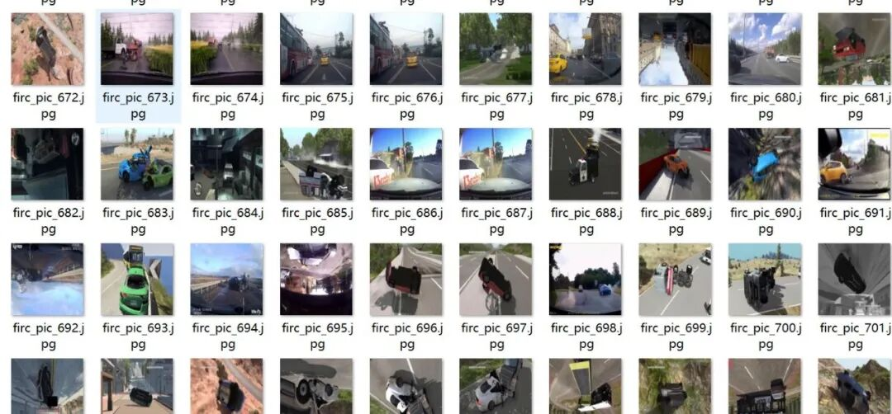
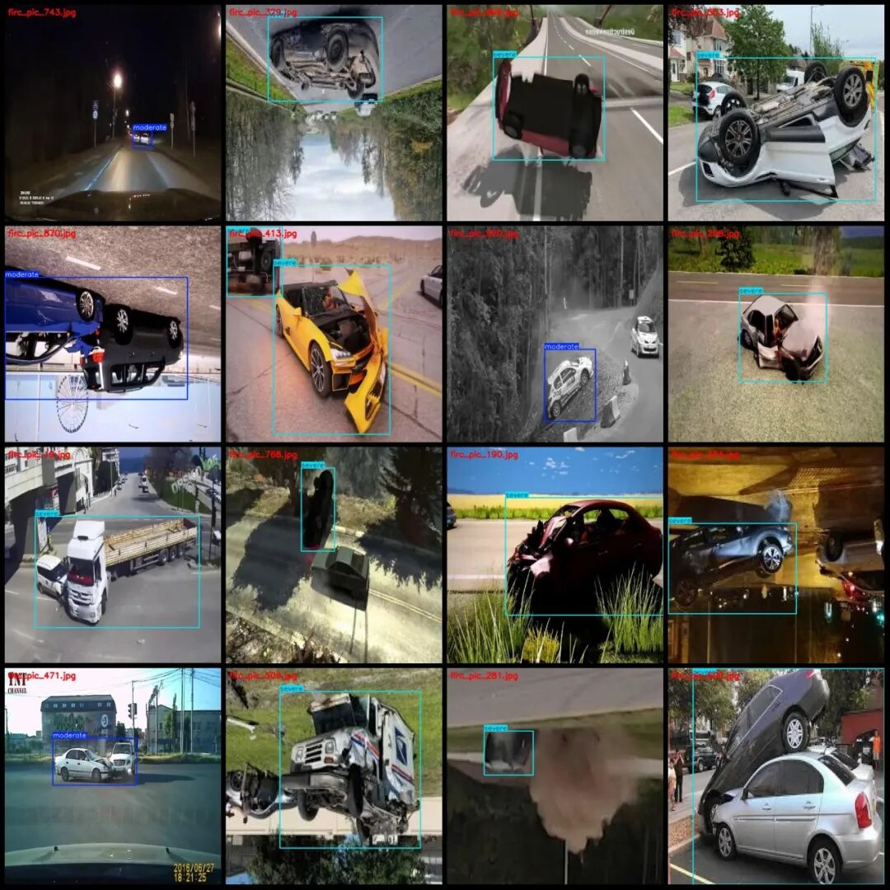
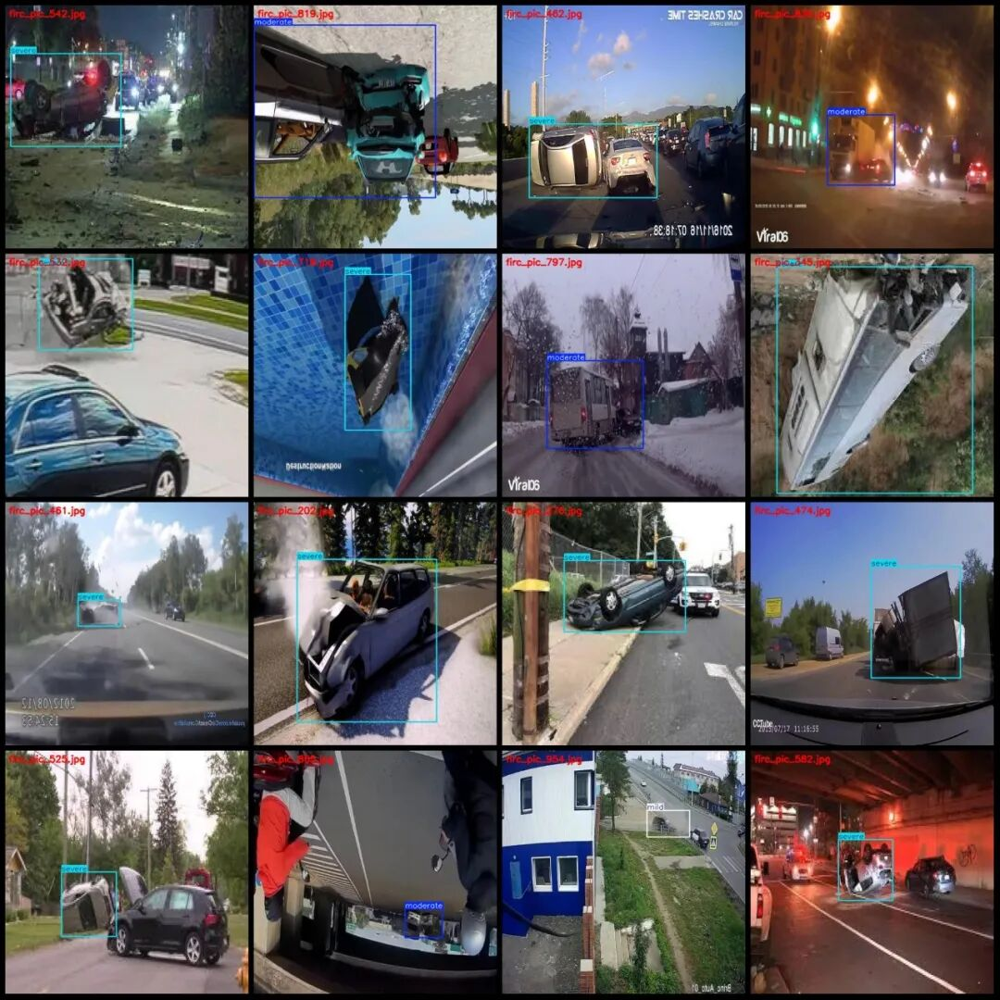

# Vehicle Traffic Accident Severity Detection Dataset VOC+YOLO format, 963 images in 3 categories

Dataset format: Pascal VOC format + YOLO format (txt file without split path, only containing jpg images and corresponding VOC format xml files and yolo format txt files)

Number of images (number of jpg files): 963

Number of annotations (number of xml files): 963

Number of annotations (number of txt files): 963

Label category count: 3

Label category names (Note that the order of yolo format categories does not correspond to this, but is based on the labels folder's classes.txt): ["mild", "moderate", "severe"]

Number of boxes labeled in each category:

Mild (mil) = 50

Moderate (moderate) Frames = 261

severe (severe) frame count = 700

Total frame count: 1011

Number of images per category:

Mild (mil) = 42

Moderate (moderate) Ownership of the image = 259

Severe (severe) occupancy of the image count = 665

Image resolution: 640x640

Using labelImg:

Annotation rules: Draw a rectangle around the category.

Important Notice: The dataset does not have separate training, validation, and test sets; you need to partition them yourself.

Special : This dataset does not guarantee the accuracy of the trained models or weight files.

Image Preview:

Annotation example:

## Payment

Here is a pay link on Stripe ( https://buy.stripe.com/3cs8yP7sY87d0vu9AB ). Please contact me lonlonago@foxmail.com after funding $89, and I will send you a complete data files , thank you!

